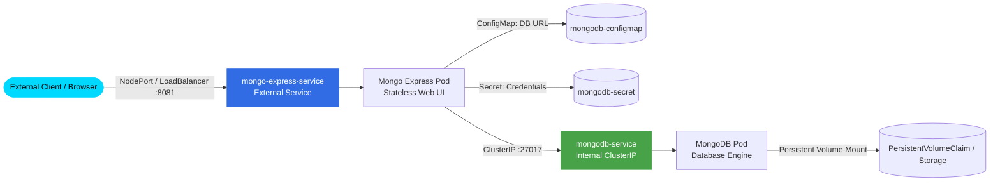

<div align="center">

# ☸️ Kubernetes MongoDB & Mongo Express Stack (`k8s-mongodb-deployment`)

**Production-Style Stateful & Stateless Microservice Orchestration on Kubernetes**

[](https://kubernetes.io/)
[](https://www.mongodb.com/)
[](https://www.docker.com/)
[](https://github.com/NejamulHaque/k8s-mongodb-deployment)

</div>

---

### 📌 Overview

This repository demonstrates a multi-tier **Kubernetes deployment** orchestrating a persistent **MongoDB** database backend alongside a web-based **Mongo Express** admin UI. It implements Kubernetes native configuration isolation, encrypted secret management, internal service discovery (CoreDNS), and external ingress routing.

---

### 🏗️ Cluster Architecture



---

### ✨ Key Engineering Highlights

* **Zero Hardcoded Credentials:** Database root usernames and passwords are base64-encoded inside a Kubernetes `Secret` (`mongo-secret.yaml`) and injected as environment variables at runtime.
* **Decoupled Configuration:** Non-sensitive service endpoints (`mongodb-service`) are isolated inside a `ConfigMap` (`mongo-configmap.yaml`) so application manifests remain environment-agnostic.
* **Internal vs. External Service Isolation:**
  * **MongoDB (`ClusterIP`):** Strictly reachable only inside the cluster network on port `27017`—never exposed to the public internet.
  * **Mongo Express (`NodePort` / `LoadBalancer`):** Exposes the admin dashboard externally on port `8081` while communicating internally with MongoDB over CoreDNS.
* **Self-Healing Workload Management:** Configured with Kubernetes `Deployment` controllers, replica health monitoring, and resource limits to prevent noisy-neighbor memory starvation.

---

### 📂 Repository Structure

```text
k8s-mongodb-deployment/
├── mongo-secret.yaml          # Base64-encoded MongoDB root credentials
├── mongo-configmap.yaml       # Internal database URL configuration
├── mongo-deployment.yaml      # MongoDB Pod spec, volume mounts, & ClusterIP Service
├── mongo-express.yaml         # Mongo Express Pod spec & external NodePort/LB Service
└── README.md                  # Architecture, deployment guide, & troubleshooting
```

---

### 🚀 Quick Start & Deployment

#### 1. Prerequisites
* Local or cloud Kubernetes cluster (`minikube`, `kind`, `k3s`, or EKS/GKE)
* `kubectl` CLI configured and connected to your cluster

#### 2. Apply Manifests in Dependency Order
```bash
# 1. Create Secrets and ConfigMaps first
kubectl apply -f mongo-secret.yaml
kubectl apply -f mongo-configmap.yaml

# 2. Deploy MongoDB backend and internal ClusterIP Service
kubectl apply -f mongo-deployment.yaml

# 3. Deploy Mongo Express UI and external Service
kubectl apply -f mongo-express.yaml
```

#### 3. Verify Cluster State
```bash
# Check Pods, Deployments, Services, Secrets, and ConfigMaps
kubectl get all
kubectl get configmap,secret
```

#### 4. Access the Mongo Express Dashboard
* **On Minikube:**
  ```bash
  minikube service mongo-express-service
  ```
* **On Kind / Codespaces / Local NodePort:**
  ```bash
  kubectl port-forward svc/mongo-express-service 8081:8081
  ```
  Open `http://localhost:8081` in your browser and authenticate using the credentials defined in `mongo-secret.yaml`.

---

### 🛡️ DevSecOps & Production Hardening Checklist

* [x] **Network Segmentation:** MongoDB isolated behind an internal `ClusterIP` service.
* [x] **Secret Externalization:** Credentials separated from Deployment YAML specs via `Secret` resources.
* [ ] **Next Upgrade:** Migrate MongoDB from `Deployment` to a `StatefulSet` with a `PersistentVolumeClaim` (`PVC`), `NetworkPolicy` ingress restrictions, and Trivy/Checkov Kubernetes manifest scanning in GitHub Actions.

---

### 🧹 Cleanup

To tear down all deployed Kubernetes resources cleanly:
```bash
kubectl delete -f mongo-express.yaml
kubectl delete -f mongo-deployment.yaml
kubectl delete -f mongo-configmap.yaml
kubectl delete -f mongo-secret.yaml
```

---

<div align="center">
  <sub>Built & maintained by <a href="https://github.com/NejamulHaque">Nejamul Haque</a> • DevSecOps & Cloud Infrastructure Portfolio</sub>
</div>
